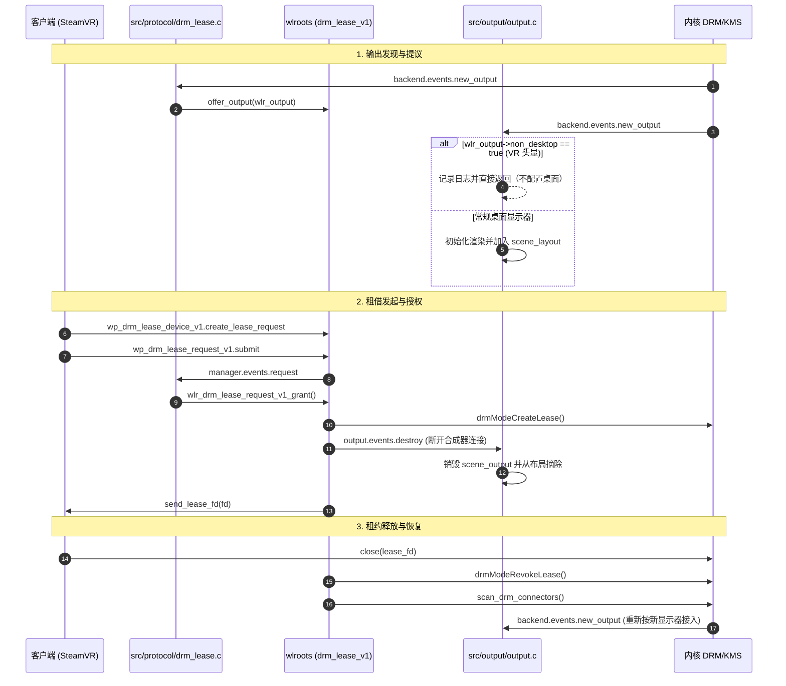

# wp_drm_lease_device_v1 协议支持设计与实现说明

> 日期：2026-11-04  
> 状态：已实现并合入 `feature/drm-lease-v1`  
> 参考基线：wlroots 0.20.2、`/home/rewine/labwc`（`src/server.c` / `src/output.c`）

---

## 1. 背景与目标

### 1.1 协议背景
Wayland 原生基于合成管线（Compositor Composition），所有客户端 Surface 必须经由合成器的图层树（wlr_scene）合成后上屏。这无法满足需要**硬件级独占访问与极低延迟直接呈现**的应用场景：
- **VR/XR 运行时**（如 SteamVR、Monado、OpenXR 驱动）：需对 VR 头显（HMD）显示硬件进行直接扫描输出（Direct Mode / KMS Scanout），避免经过桌面合成器带来的额外帧延迟与色彩空间损失。
- **全屏独占与直接呈现工具**（如 Gamescope）：在支持时接管特定显示器，直接管理硬件平面（Planes）和 Presentation。

`wp_drm_lease_device_v1`（属于 `drm-lease-v1` 协议扩展）允许 Wayland 客户端作为承租方（Lessee），从作为 DRM Master 的合成器处租借特定的 DRM 资源（Connector、CRTC、Plane）并获得专属 DRM 文件描述符（Lease FD），直接向内核发起 PageFlip 与硬件控制。

### 1.2 核心目标
1. **协议支持**：实现 `wp_drm_lease_device_v1` 服务端能力，与 wlroots 的 `wlr_drm_lease_v1_manager` 完成生命周期与事件闭环。
2. **非桌面显示器隔离（Non-Desktop Isolation）**：自动识别 VR 头显（`wlr_output->non_desktop = true`），避免将其配置为桌面显示器（不创建桌面图层树、不绘制壁纸和面板、不映射鼠标焦点与光标）。
3. **架构解耦**：遵循 Woodland 单向依赖约定，输出模块（`output_lib`）不反向依赖协议模块（`protocol_lib`）。
4. **环境兼容与幂等性**：在 Headless、X11 或 Wayland-nested 等非 DRM 运行环境下平滑降级（无报错、不阻塞 CI 冒烟测试）；支持热插拔与重复 offer/withdraw 幂等防护。

---

## 2. 模块划分与生命周期

```
   +--------------------------------------------------------+
   |                woodland_server (main)                  |
   +---------------------------+----------------------------+
                               |
              +----------------+----------------+
              |                                 |
              v                                 v
   +---------------------+           +----------------------+
   | src/output/output.c |           | src/protocol/        |
   | (桌面渲染与布局)    |           | drm_lease.c          |
   +----------+----------+           +----------+-----------+
              |                                 |
              | non_desktop 过滤                | offer/withdraw/grant
              v                                 v
   +---------------------+           +----------------------+
   |  普通桌面显示器     |           |  wlr_drm_lease_v1_   |
   | (scene/layer/layout)|           |  manager             |
   +---------------------+           +----------+-----------+
                                                |
                                                | Wayland 协议事件
                                                v
                                     +----------------------+
                                     | 客户端 (SteamVR 等)  |
                                     +----------------------+
```

### 2.1 协议族状态（`src/protocol/drm_lease.c`）
DRM Lease 归入 `woodland_proto` 聚合层，内部私有状态如下：
```c
struct woodland_proto_drm_lease {
    struct woodland_proto *owner;
    struct woodland_server *server;

    struct wlr_drm_lease_v1_manager *manager;
    struct wl_listener request;     // manager->events.request
    struct wl_listener new_output;  // server->backend->events.new_output
};
```

1. **初始化（`woodland_proto_drm_lease_init`）**：
   - 依赖 `server->display` 与 `server->backend` 创建 `wlr_drm_lease_v1_manager`。
   - 若当前后端非 DRM（如无头后端），返回成功但保持 `manager = NULL`，平滑降级。
   - 注册 `events.request` 监听器与 `backend->events.new_output` 监听器（均使用 `woodland_listener_connect` 记入运行时账本）。
   - 遍历现有 `server->outputs` 补齐已有输出提议。
2. **销毁（`woodland_proto_drm_lease_finish`）**：
   - 逆序摘除 `new_output` 与 `request` 监听器。
   - 确保在 `wl_display_destroy` 触发前，`manager->events.request` 的监听器链表已清空，满足 wlroots 校验断言。

### 2.2 租借申请与授权时序



---

## 3. 关键设计考量与不变量

### 3.1 非桌面设备（VR 头显）隔离
- **原因**：VR 头显（如 Valve Index、HTC Vive 等）其 EDID 中包含 `non-desktop` 标志（由驱动置位 `wlr_output->non_desktop = true`）。若合成器将其当成普通显示器接入，会导致桌面壁纸、面板、鼠标光标出现在头显镜片内。
- **实现**：
  - `src/output/output.c` 在 `handle_new_output()` 入口处检查 `wlr_output->non_desktop`，若是则直接返回，不创建 `woodland_output`，不分配 layer tree 与 scene output。
  - `src/server/server.c` 的 `handle_new_output_broadcast()` 跳过针对 `non_desktop` 输出的 output-management 布局广播。

### 3.2 模块解耦与测试独立性
- `output_lib` 保持为纯净的几何与渲染输出库，由 `test_output` 独立测试，不引入对 `protocol_lib` 的反向链接依赖。
- `drm_lease.c` 独立监听 `server->backend->events.new_output` 获取输出事件，无需 `output.c` 调用协议层。

### 3.3 提议去重与状态幂等（`is_output_offered`）
- 在调用 `wlr_drm_lease_v1_manager_offer_output` 和 `withdraw_output` 前，通过 `is_output_offered()` 遍历 `manager->devices->connectors` 检查输出是否已处于提议状态。
- 防止输出初始化与热插拔重叠触发时，产生 wlroots 报错日志（`Output %s has already been offered`）。

---

## 4. 接口说明

### 公开接口（`include/protocol.h`）
```c
/** 将 DRM 输出提议给 DRM lease 管理器 */
void woodland_protocol_offer_drm_lease(struct woodland_server *server,
                                       struct wlr_output *output);

/** 从 DRM lease 管理器撤回 DRM 输出提议 */
void woodland_protocol_withdraw_drm_lease(struct woodland_server *server,
                                          struct wlr_output *output);
```

### 协议层内部接口（`src/protocol/protocol_internal.h`）
```c
bool woodland_proto_drm_lease_init(struct woodland_proto *proto);
void woodland_proto_drm_lease_finish(struct woodland_proto *proto);
void woodland_proto_drm_lease_offer_output(struct woodland_proto *proto,
                                           struct wlr_output *output);
void woodland_proto_drm_lease_withdraw_output(struct woodland_proto *proto,
                                              struct wlr_output *output);
```

---

## 5. 测试与验证

1. **单元测试（`tests/unit/test_drm_lease.c`）**：
   - 验证协议层与 DRM Lease 模块的完整创建与逆序拆卸。
   - 验证无头后端下的安全降级（`manager = NULL`）。
   - 验证对 NULL 指针调用公开接口的防护。
   - 验证对非 DRM 输出调用 offer/withdraw 的无操作安全性与多次调用幂等性。
2. **输出隔离测试（`tests/unit/test_output.c`）**：
   - 验证 `wlr_output->non_desktop = true` 的输出不会被分配 `woodland_output`，也不会进入 `server->outputs` 链表。
3. **ASan / UBSan 验证**：
   - 保证退出与拔除路径无内存泄漏和非法内存访问。
